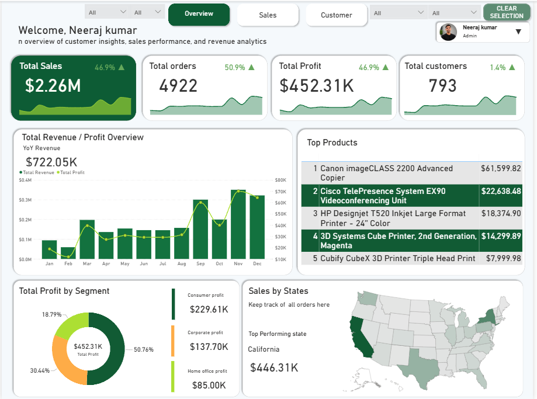
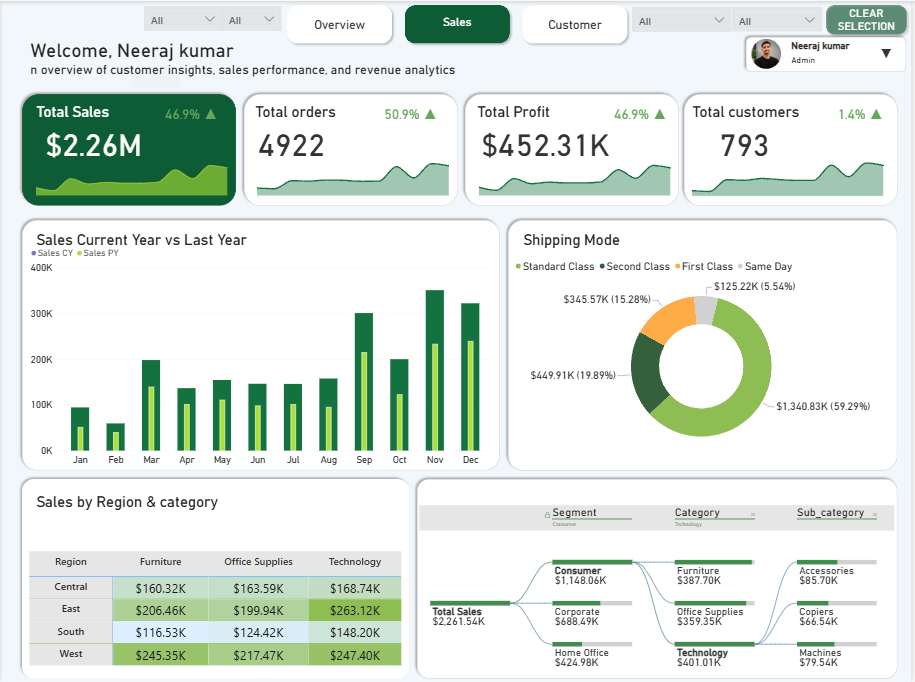
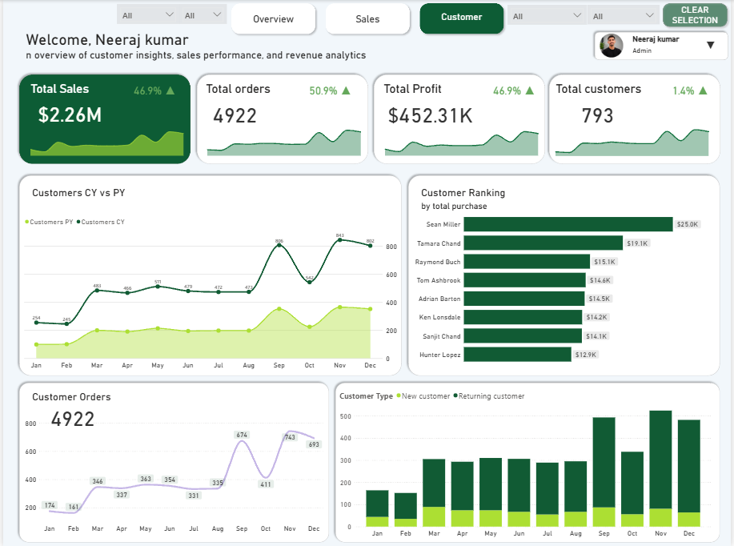

# Sales Performance Analysis Dashboard

A business intelligence portfolio project exploring sales, customer, product, geographic, segment, and shipping performance using SQL query analysis and Power BI.

## Dashboard Preview






## Project Overview
The Power BI dashboard has three pages:
- **Overview:** sales and profit trends, top products, profit by segment, and sales-by-state map.
- **Sales:** current-year versus prior-year monthly sales, shipping-mode sales distribution, region/category matrix, and segment/category/sub-category breakdown.
- **Customer:** customer trend comparison, customer purchase ranking, monthly customer orders, and new versus returning customer comparison.

Dashboard screenshots are available in `Dashboard/`. The full business-question answers, insights, recommendations and validation notes are in `Sales_Performance_Project_Report.pdf`.

## Tools and Technologies
- **Power BI:** dashboard pages, KPI cards, slicers, trend charts, donut charts, matrix, decomposition visual and map.
- **SQL / MySQL:** business analysis across products, customers, time, geography, segments and shipping. The additional query-answer PDF identifies its syntax as MySQL.
- **Data analysis and storytelling:** turn query results into insights and practical recommendations.
- **GitHub / Markdown:** project documentation and portfolio presentation.

## Key Results
| Metric | Result |
|---|---:|
| Total sales | $2,261,536.97 |
| Leading sub-category | Phones, $327,782.49 |
| Top product in main SQL results | Canon imageCLASS 2200 Advanced Copier, $61,599.83 |
| Highest-sales state | California, $446,306.49 |
| Highest-sales region | West, $710,219.77 (31.40%) |
| Top customer by sales | Sean Miller, $25,043.07 |
| Top ten customers' share of sales | 6.80% |
| Most-used shipping mode | Standard Class, 5,859 orders |
| Longest average regional shipping time | Central, 4.07 days |
| Highest monthly sales in supplied series | November 2018, $117,938.14 |

## Business Questions Covered
The PDF report includes all 10 main questions and all 16 additional questions, including:
- Total sales and sales by category/sub-category
- Top products overall, by category, and by region
- Sales by state, city, region, and segment
- Monthly sales trend from 2015 to 2018
- Top customers by revenue and order count
- Customer count by segment and top-ten customer contribution
- Low-selling products
- Shipping mode usage, average sales and delivery times

## Key Business Insights
- Phones is the leading sub-category, followed by Chairs and Storage.
- The Canon imageCLASS 2200 Advanced Copier is the top product in the main SQL answer sheet.
- West is the largest region by sales share, followed by East.
- California and New York lead state sales; New York City leads the supplied city ranking.
- The top ten customers account for 6.80% of sales in the additional query output.
- Consumer is the largest segment by unique customer count.
- November 2018 is the highest month in the supplied monthly series.
- Standard Class is the most frequently used shipping mode.
- Central has the longest average regional shipping time.

## Business Recommendations
1. Review inventory and replenishment for high-demand sub-categories, while checking margins and stockout risk.
2. Test targeted campaigns and bundles around leading products, measuring profit and conversion as well as sales.
3. Study strong performance in West and East, then test suitable strategies in Central and South.
4. Use high-value and frequent-order customers for relevant loyalty and re-engagement campaigns.
5. Review pricing, availability and listing quality for low-selling items before changing assortment.
6. Investigate Central and slower-shipping states for fulfilment or carrier issues.
7. Prepare inventory and campaigns ahead of September to December, validating seasonality across years.
8. Track profit and margin alongside sales by product, region, category and segment.
9. Reconcile SQL outputs and Power BI measures before publishing.

## Dashboard Features
- Overview, Sales and Customer pages
- KPI cards for Total Sales, Total Orders, Total Profit and Total Customers
- Dropdown slicers and Clear Selection control
- Year-over-year monthly comparison
- Product and customer rankings
- Region/category matrix and segment/category/sub-category decomposition
- Shipping-mode distribution and state sales map
- New versus returning customer comparison


## Repository Structure
```text
Sales_Performance_Project/
├── README.md
├── Sales_Performance_Project_Report.pdf
├── Dashboard/
├── ├──Overview.png
│   ├──Sales.png
│	├──Customer.png
│	└──Sales_performance.PBIX
├── Dataset/
│   ├── sales_performance.csv
│   └──us_states_long_lat_code.csv
├── sql/
│    ├──sales analysis/
│    ├──Customer analysis/
│    ├──Geographical analysis/
│	 ├──Product analysis
│	 └──shipping analysis/
│    	
└── .gitignore
```

## Portfolio Skills Demonstrated

This project demonstrates:

- Business problem understanding
- KPI development
- Power BI dashboard design
- DAX
- YTD and YoY analysis
- Customer segmentation analysis
- sales analysis
- customer analysis
- Product performance analysis
- Geographic sales analysis
- Shipping analysis
- Business insight generation
- Data storytelling
- Executive-style dashboard presentation


## Author

**Neeraj Kumar**


